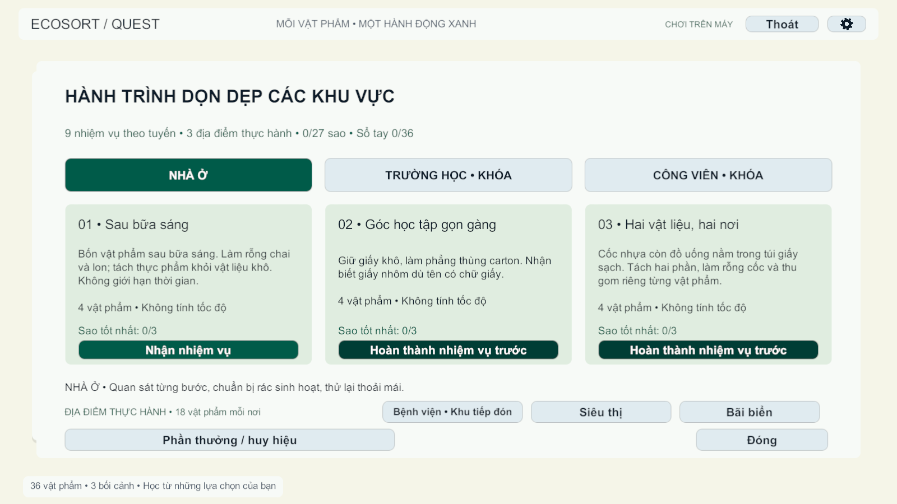
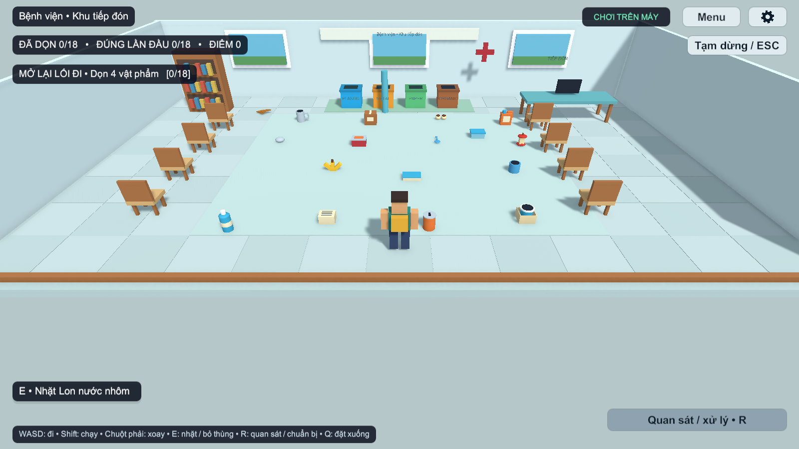
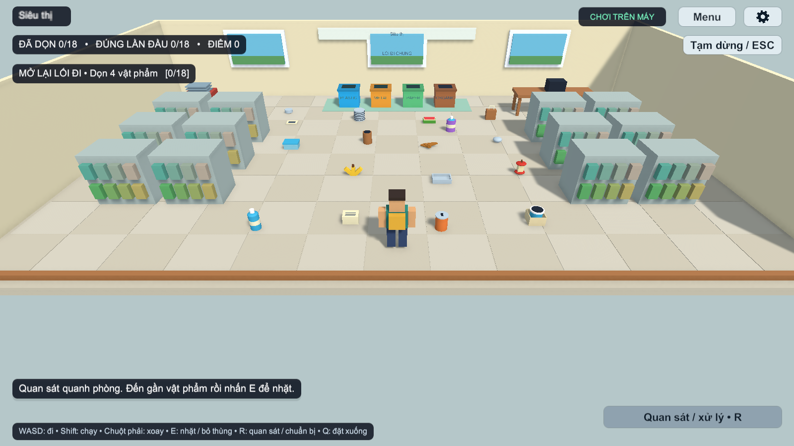
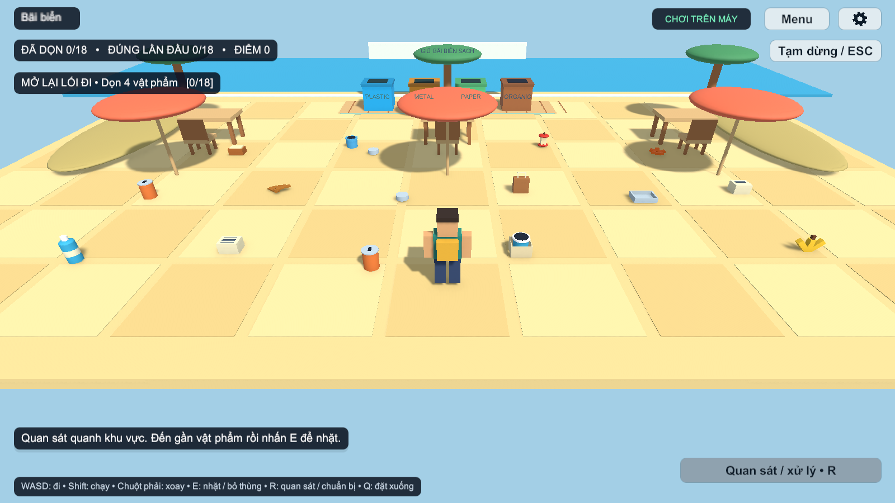

# Kiểm chứng hành trình dọn dẹp các khu vực

Ngày kiểm chứng: 12/11/2026. Bản cập nhật gộp chín nhiệm vụ Nhà ở, Trường học, Công viên và ba địa điểm thực hành vào một màn **Hành trình dọn dẹp các khu vực**.

| Phạm vi | Kết quả | Bằng chứng cục bộ |
|---|---|---|
| Logic Unity | 70/70 đạt | `Logs/Journey-EditMode-20261112.xml` |
| Ba cảnh thực hành | 1/1 đạt | `Logs/Journey-ExtraPlayMode-20261112.xml` |

Lượt PlayMode tạo Bệnh viện, Siêu thị và Bãi biển; kiểm tra mỗi cảnh có 4 thùng, 18 vật phẩm, không có vật phẩm chồng nội thất có collider, sau đó thực hiện nhặt, chuẩn bị/tách khi cần và bỏ đúng đủ 18 vật phẩm. Ca này không dùng dịch vụ mạng.

Các ảnh bên dưới là cảnh kiểm thử trước khi người chơi dọn rác. Chúng thể hiện bố cục và số lượng đồ vật của bản demo; không phải ảnh nghiệm thu với trẻ em hoặc phép đo FPS.

