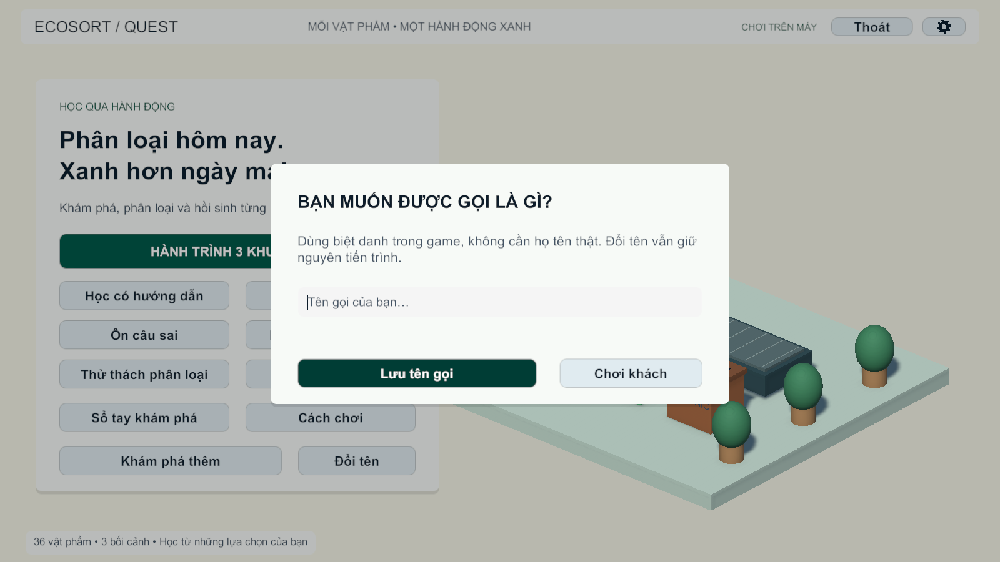
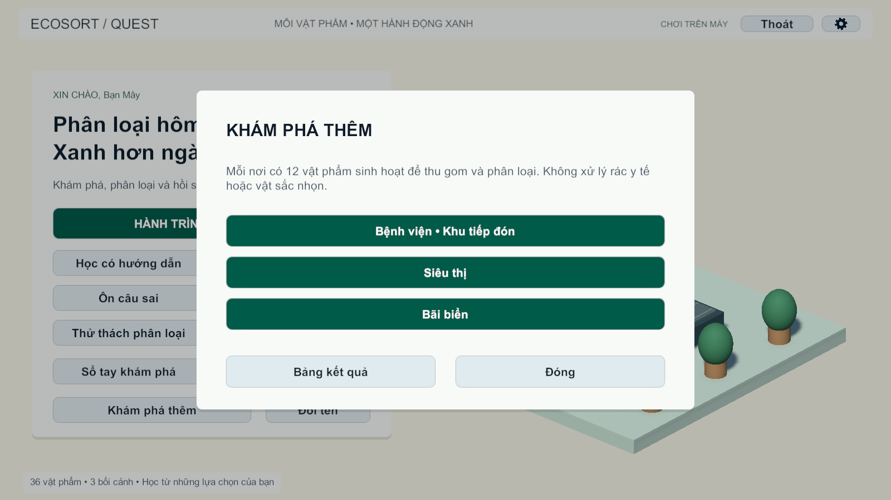
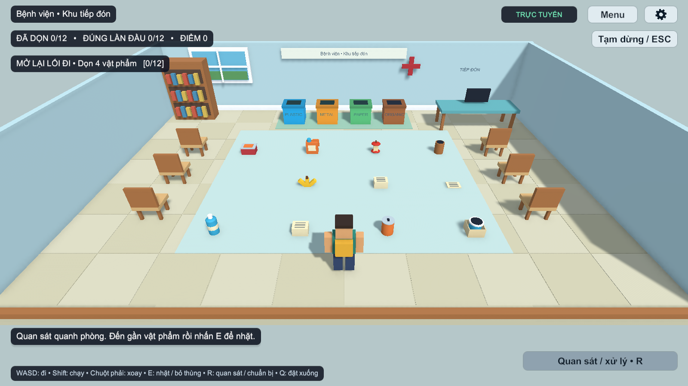
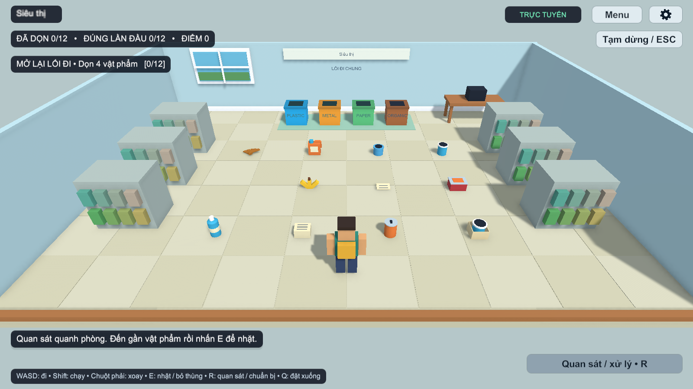
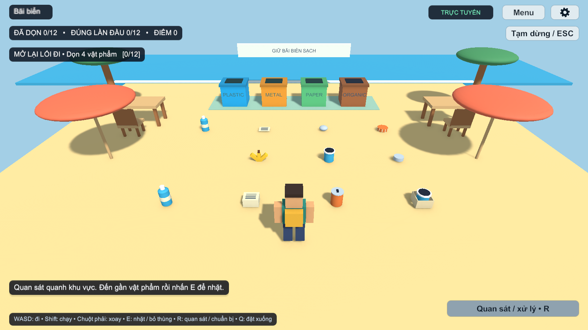

# Kiểm chứng menu, môi trường bổ sung và bảng kết quả

Ngày kiểm chứng: 01/11/2026. Unity 6000.6.2f1, Windows, FastAPI và Docker Desktop trên máy phát triển.

## Kết quả đã đo

| Phạm vi | Kết quả | Bằng chứng gốc trên máy |
|---|---|---|
| Unity EditMode | 70/70 đạt | `Logs/Menu-EditMode-20261101.xml` |
| Unity PlayMode toàn bộ | 34/34 đạt, không bỏ qua | `Logs/Menu-PlayMode-20261101.xml` |
| Kiểm tra cuối tên và gửi điểm Adafruit | 2/2 đạt | `Logs/Menu-Adafruit-Final-20261101.xml` |
| Python backend | 18/18 đạt | `Logs/Menu-Backend-20261101.xml` |
| Windows player | Build thành công, báo cáo 108.624.926 byte | `Logs/Menu-WindowsBuild-20261101.log` |
| Dịch vụ cổng 8000 | `/health` trả ok, `adafruit_io`, 12 lớp | Kiểm tra trực tiếp sau cập nhật |
| Thư viện container | `pip check`: No broken requirements found | Chạy trong `ecosort-api` sau cập nhật |
| Adafruit thật | Unity gửi mẫu 40 điểm, trang đọc lại tên Kiểm thử Dashboard, mã debug-dashboard-20261101 và 4 câu đúng | `Logs/Menu-Adafruit-Final-20261101.xml`, ảnh Dashboard bên dưới |

Đường dẫn log tính từ thư mục Unity `ECOSORT_GAME`. Log và bản build không được đưa vào Git; ảnh và biên bản này được lưu cùng mã nguồn.

PlayMode toàn bộ dùng dịch vụ Docker riêng tại cổng 8030 với kho dữ liệu cục bộ. Kiểm thử ba môi trường thực hiện đủ 12 vật phẩm/cảnh, đọc lại điểm 120 và tên gọi đúng qua `/dashboard/data`. Bộ này còn chạy luồng nhận diện mô hình thật và kiểm tra webcam đã có. Bằng chứng Adafruit ở hàng riêng là lần gửi/đọc thật qua cổng 8000, không suy ra từ dịch vụ cục bộ.

SHA-256 `EcoSortQuest.Runtime.dll` của bản Windows: `AE8F53FA2F7C18F62567CEE6FE8A995C8A302FBB2E6298F65363DB286F72C6A3`.

SHA-256 model trong dịch vụ sau cập nhật: `c94553614878308bc219487c2910de23ff2dd5a686737014cdc96a540e18814f`.

## Kiểm tra giao diện và tích hợp

- MainMenu đã gắn đủ thành phần; nhập tên lần đầu và đổi tên dùng Canvas có sẵn, giữ nguyên mã người chơi và điểm cũ.
- Bệnh viện có quầy tiếp đón, ghế chờ, biển chỉ dẫn; siêu thị có kệ hàng và quầy thanh toán; bãi biển có cát, nước, ô che và cây. Kiểm thử phát hiện vật phẩm chồng nội thất bằng kiểm tra collider và thực hiện nhặt/chuẩn bị/thả. Nhân vật được đặt gần vật phẩm trong kiểm thử nên không coi đây là nghiệm thu toàn bộ đường đi thủ công.
- Dashboard đã xem trong trình duyệt ở bố cục hẹp: các thẻ xếp dọc, bảng xuống dòng, đọc được dữ liệu thật và không có lỗi console. Trang tự tải lại dữ liệu mỗi 5 giây.
- Script kiểm tra không tự gửi khi Play; chỉ gửi sau thao tác chủ động. HTML không giữ khóa Adafruit; khóa vẫn nằm trong `.env` không theo dõi bởi Git.
- Dịch vụ mới giữ volume và cấu hình hiện có. Dữ liệu sao lưu tại `backend/data/docker-backup-20261101`; image cũ giữ dưới tag `ecosort-api:before-menu-20261101`. Khi cần khôi phục, gắn lại tag cũ thành `ecosort-api:local`, rồi chạy Compose với `up -d --no-build`.

## Giới hạn còn lại

Chưa có buổi thử với trẻ em, đo hiệu quả giáo dục hoặc đo FPS trước/sau của bản này. Ba cảnh là hình khối dựng bằng mã cho đồ án demo, không phải mô phỏng bệnh viện hoặc nghiệp vụ xử lý rác y tế. Dashboard chỉ xem tối đa 100 bản ghi mới nhất của nguồn trước khi lọc; điểm client chưa được xác thực và dữ liệu kiểm tra phải phân biệt với kết quả học thật. Không nghiệm thu AR điện thoại trong đợt này.

## Ảnh kiểm chứng

[Ảnh bảng kết quả Adafruit thật](Evidence/Menu-20261101/dashboard-adafruit-20261101.png).
