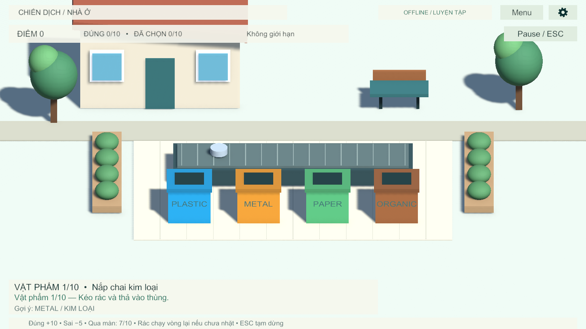

# EcoSort Quest

**Nhiệm vụ phục hồi khu vực (23/10/2026):** trong Khám phá 3D, nhận nhiệm vụ 12 vật phẩm với ba mốc hồi sinh cảnh quan; quan sát tình trạng, làm rỗng vật chứa, chuẩn bị giấy sạch và tách cốc nhựa khỏi túi giấy trước khi phân loại. Có sửa sai, sao hoàn thành và ngắm thành quả. Xem [hướng dẫn nhiệm vụ](ECOSORT_GAME/Docs/RESTORATION-GAMEPLAY.md).

**Bản bốn nhóm rác và Khám phá 3D (15/10/2026):** 36 vật phẩm theo Nhà ở/Trường học/Công viên; thêm Organic, nhân vật đi nhặt rác và bốn thùng. Vào **Học tập / AI / Thống kê → chọn bối cảnh → Khám phá 3D**. Mô hình bốn lớp đã huấn luyện và tích hợp vào backend. Xem [cách chơi, kết quả AI và cập nhật Docker](ECOSORT_GAME/Docs/ORGANIC-EXPLORATION.md).

**Nâng cấp học tập 15/10/2026:** Menu → Học tập / AI / Thống kê để chọn Học, Kiểm tra, Ôn câu sai, ba bối cảnh và nhiệm vụ vật thật. Có lịch sử từng đáp án và API riêng; xem [hướng dẫn nâng cấp](ECOSORT_GAME/Docs/LEARNING-UPGRADE.md). Cập nhật backend cùng client để dùng `/learning/sessions`.

Xác minh bản nâng cấp: **23/23 EditMode, 12/12 PlayMode, 7/7 backend**, có ca Unity–FastAPI lịch sử thật trên backend local riêng; Windows build thành công. Chưa nghiệm thu webcam/loa, ảnh mới hay Docker/cloud của bản mới. Chi tiết trong [TESTING](ECOSORT_GAME/Docs/TESTING.md).

Game giáo dục phân loại rác trên Windows, Unity 6000.6.2f1 + FastAPI + MobileNetV2 + Adafruit IO.

Giữ chuột để kéo vật phẩm đang chạy trên băng chuyền, thả vào thùng Nhựa / Kim loại / Giấy / Hữu cơ; hoặc chọn Khám phá 3D để điều khiển nhân vật đi nhặt rác. Có 36 mẫu vật phẩm, sổ tay kiến thức, ba level với độ khó tăng dần, pause, lưu tiến trình và thử thách AR mô phỏng sau chiến dịch.



**Đọc [hướng dẫn đầy đủ](HUONG-DAN-CHAY-PROJECT.md)** để cài đặt trên máy mới, chạy Python hoặc Docker, cấu hình Adafruit và xử lý lỗi.

## Bắt đầu sau khi clone

1. Clone repo rồi mở thư mục `ECOSORT_GAME` bằng Unity Hub, Editor **6000.6.2f1**. Chờ import packages.
2. Mở `Assets/_EcoSortQuest/Scenes/MainMenu.unity`, Play → **Kết nối backend → Chơi ngoại tuyến** để thử game ngay.
3. Muốn nhận diện ảnh thật, cài Python 3.12 64-bit và chạy từ thư mục repo:

```powershell
cd backend
py -3.12 -m venv .venv
.\.venv\Scripts\python.exe -m pip install -r requirements.txt
Copy-Item .env.example .env
.\.venv\Scripts\python.exe -m uvicorn app.main:app --env-file .env --host 127.0.0.1 --port 8000
```

Chỉ chép `.env.example` ở lần đầu chưa có `.env`. Mở <http://127.0.0.1:8000/health>, sau đó trong game chọn **Kết nối backend → Online**, URL `http://127.0.0.1:8000`.

Nếu dùng Docker Desktop thay Python:

```powershell
cd backend
docker compose up -d --build
```

Không chạy hai backend trên cùng cổng. Docker cần Linux containers và Compose hỗ trợ `env_file.required`. Bật cloud bằng cấu hình `.env` riêng, tạo đủ sáu feed như [hướng dẫn](HUONG-DAN-CHAY-PROJECT.md#7-bật-adafruit-io).

## Cấu trúc

| Đường dẫn | Nội dung |
|---|---|
| `ECOSORT_GAME/Assets/_EcoSortQuest` | Scene, game scripts, model 3D bằng primitive và Unity tests |
| `ECOSORT_GAME/Docs` | Contract, kiểm thử, ảnh minh chứng |
| `backend/app` | API, storage, cloud adapter, model phục vụ inference |
| `backend/tests` | Kiểm thử backend và cloud transport mô phỏng |
| `ai-model` | Mã huấn luyện/đánh giá và tài liệu AI; không cần để chơi |

Checkpoint phục vụ game được giữ tại `backend/app/ai_model/artifacts/model.keras` cùng metadata. Không cần tải Dataset hoặc huấn luyện lại để chạy. Raw dataset và các checkpoint huấn luyện phụ không nằm trong repo.

## Luật chơi và nội dung học

- 10 vật phẩm/lượt, đúng +10, sai −5 (điểm không âm), cần 7/10 để qua màn.
- Level 1 không giới hạn giờ, có gợi ý chất liệu; Level 2/3 giới hạn 75/50 giây. Timer dừng khi pause và khi đọc phản hồi đáp án.
- Sáu mẫu mỗi nhóm; level đầu dùng mẫu dễ, level cuối lấy từ toàn bộ danh mục. Rác chưa nhặt vòng lại; thả ngoài thùng không tính câu và trả vật phẩm về băng chuyền.
- Phản hồi giải thích vật liệu và cách chuẩn bị trước thu gom; sổ tay có đủ 18 bài học.
- Màu thùng là quy ước của game. Danh mục mô tả vật phẩm sạch, vật liệu chính; khả năng thu gom thực tế phụ thuộc địa phương. Không đưa pin, hóa chất hoặc rác nguy hại vào ba nhóm này.

## Phạm vi kỹ thuật

Ngoại tuyến: gameplay và sổ tay hoạt động độc lập; Scan ở chế độ luyện tập trả nhãn được chọn, **không phải AI**. Online: Unity gửi ảnh tới model thật tại backend; tiến trình/điểm/kết quả có thể đẩy lên Adafruit. Backend mặc định lưu JSON local, cloud cần `.env` và Internet.

Thử thách là **mô phỏng 3D trên PC**, chưa phải ARCore/AR Foundation trên thiết bị. Adafruit adapter hiện phục vụ một demo player trong snapshot gần nhất; chưa có đăng nhập, multi-user backend hoặc hàng đợi bền vững gửi lại lịch sử. Nhiều mẫu 3D không mở rộng ba nhãn mà model AI đã học.

Không chia sẻ `.env`, key, `.venv`, Unity `Library`, `Logs` hoặc dữ liệu người chơi. `.gitignore` đã loại các thành phần này; giữ mọi `.meta` của asset. Mô hình game dựng bằng Unity primitive, không cần asset trả phí. Dataset huấn luyện cần kiểm tra giấy phép nguồn riêng trước khi phân phối.

## Kiểm thử và build

Unity: `Window → General → Test Runner`, chạy EditMode rồi PlayMode. PlayMode dùng service mock được cô lập để không ghi dữ liệu vào cloud của bạn. Kết quả/giới hạn xem [TESTING](ECOSORT_GAME/Docs/TESTING.md).

Ngày 13/10/2026: **20 EditMode + 8 PlayMode passed**, fixture đồ họa **1/1 passed**, backend **6/6 passed**, build Windows x64 thành công. Các test không thay thế playtest standalone hoặc kiểm thử tích hợp cloud trên máy nhận.

Backend, trong `backend`:

```powershell
.\.venv\Scripts\python.exe -m pip install -r requirements-dev.txt
.\.venv\Scripts\python.exe -m pytest -q
```

Windows build: `EcoSort → Build Windows`. Khi chia sẻ bản chạy gửi đầy đủ thư mục `Builds/Windows` trừ thư mục debug `BackUpThisFolder_ButDontShipItWithYourGame`. Source repo không chứa build output.

## Đưa lên GitHub

Tạo repo trống trên GitHub, rồi chạy tại thư mục gốc project:

```powershell
git init
git add .
git status
git diff --cached --stat
git commit -m "Add EcoSort Quest game, backend and running guide"
git branch -M main
git remote add origin https://github.com/YOUR_ACCOUNT/YOUR_REPOSITORY.git
git push -u origin main
```

Thay URL mẫu bằng repo thật; nếu đã có Git hoặc remote thì bỏ các bước tương ứng. Kiểm tra staged files trước commit: không có `.env`, key, dataset, cache hoặc log. Repo public không đồng nghĩa với cấp giấy phép sử dụng; nhóm tự chọn license phù hợp trước khi công bố. Những lệnh trên là hướng dẫn, không có thao tác tự động push lên tài khoản GitHub.

