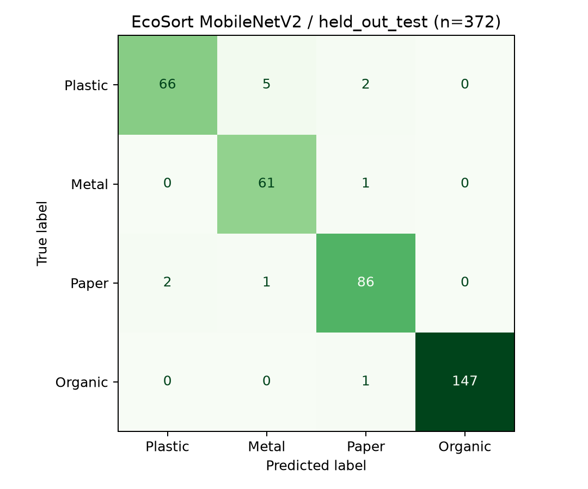

# Báo cáo đánh giá EcoSort MobileNetV2

Model: MobileNetV2 pretrained ImageNet + Global Average Pooling + Dense 128 + Dropout + Softmax 3 lớp.
Tập đánh giá: **held_out_test**, **372 ảnh**. Train/validation/test được cố định trước huấn luyện; chọn checkpoint và ngưỡng bằng validation, không dùng test để chọn model.

| Chỉ số trên toàn bộ ảnh | Kết quả |
|---|---:|
| Accuracy | 96.77% |
| Macro Precision | 0.9591 |
| Macro Recall | 0.9619 |
| Macro F1 | 0.9599 |
| Mục tiêu nội bộ Accuracy ≥85% | Đạt |
| Mục tiêu nội bộ Macro F1 ≥0.80 | Đạt |

Các mục tiêu này không phải điểm chấm hoặc bảo đảm kết quả ngoài thực tế.

| Lớp | Precision | Recall | F1 | Số ảnh |
|---|---:|---:|---:|---:|
| Plastic | 0.971 | 0.904 | 0.936 | 73 |
| Metal | 0.910 | 0.984 | 0.946 | 62 |
| Paper | 0.956 | 0.966 | 0.961 | 89 |
| Organic | 1.000 | 0.993 | 0.997 | 148 |

Ngưỡng confidence chọn từ validation: **0.75**. Coverage trên tập đánh giá: **96.51%**; accepted accuracy: **0.9805013927576601**. Accuracy/Macro F1 phía trên tính cả ảnh bị từ chối, không chỉ tính ảnh confidence cao. Chỉ số accepted accuracy là độ chính xác phân loại trong các ảnh được nhận, không phải calibration hoặc OOD accuracy.

Thời gian inference sau warmup, bao gồm giải mã/resize và model, không gồm HTTP/đọc file: median **119.1 ms**, p95 **142.4 ms**, 30 ảnh. TensorFlow 2.20.0; GPU thấy bởi TensorFlow: [].

## Giới hạn

- Dataset hiện tại có nền và điều kiện chụp hẹp. Kết quả này chưa chứng minh chất lượng trên ảnh điện thoại người dùng.
- Không có object/session ID gốc; nhóm ảnh gần nhau bằng dHash chỉ giảm rủi ro rò rỉ, không bảo đảm object-disjoint.
- Chỉ nhận diện một vật phẩm chính thuộc Plastic/Metal/Paper/Organic; không object detection hoặc phân loại nhiều vật phẩm.
- Confidence cao không bảo đảm ảnh thuộc bốn lớp. Chưa có tập unknown/OOD để đánh giá khả năng từ chối vật phẩm lạ.
- Chưa kiểm thử Unity → FastAPI → model thật hoặc ảnh chụp điện thoại độc lập.

Model SHA256: `6066774bbd847366db93a717e46c47dc15cac2b6f764613fe6170969d328da46`.
Manifest SHA256: `931d02f88d91e5694a031d2f88cf89341b5b56286cc6acf8d7aef6d0860eb383`.
Chi tiết từng ảnh: `predictions.csv`; số liệu máy đọc: `metrics.json`, `classification_report.json`.

## Đồ thị bổ sung

- `roc_pr_curves.png`: ROC và Precision–Recall one-vs-rest, AUC/AP từng lớp.
- `confusion_matrix_normalized.png`: tỉ lệ theo nhãn thật.
- `reliability_confidence.png`: reliability diagram và phân bố confidence (ECE chẩn đoán, không phải bảo đảm calibration/OOD).
- `threshold_risk_coverage.png`: coverage, accepted accuracy và selective risk theo ngưỡng; chỉ chẩn đoán test, không dùng chọn lại ngưỡng.
- `curve_metrics.json`, `probabilities.npz`: dữ liệu tái tạo đồ thị.
